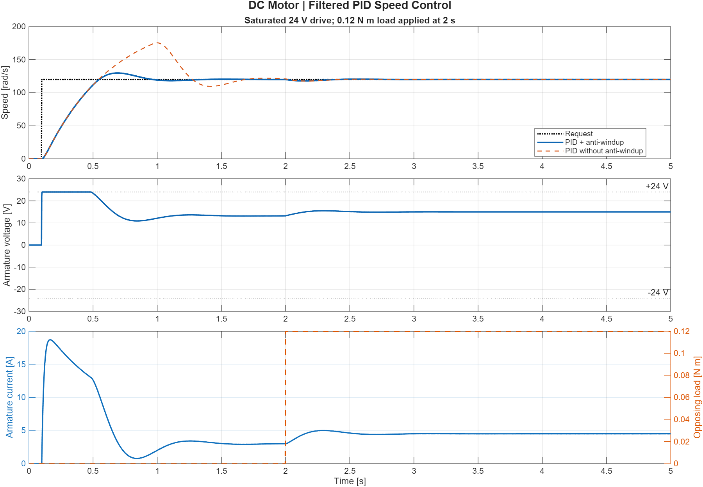

# DC Motor Speed Control

MATLAB and Simulink simulation of a DC motor with filtered PID speed control,
a **24 V drive limit**, and a **load-torque disturbance**. Compares the same
controller with and without back-calculation anti-windup.



## Run

Requires **MATLAB + Simulink**. Tested on **R2025b**; no other toolbox is required.
Clone this repository, open its folder in MATLAB, and run:

```matlab
run_demo
```

Use `run_demo(false)` for a run without a figure window. Open
`dc_motor_speed_control.slx` to inspect the editable block diagram.
[View the block diagram preview](results/model.png).
Edit `motor_parameters.m` and rerun the demo to change the experiment. The model
also stores default parameters in its model workspace for standalone execution.

## Experiment

- Speed request: **0 to 120 rad/s at 0.1 s**.
- Opposing load: **0 to 0.12 N m at 2 s**.
- Applied voltage: limited to **-24 to +24 V**.
- PID derivative acts on measured speed to avoid a reference-step derivative kick.

The motor obeys:

$$L\dot{i}=V-Ri-K_e\omega,\qquad J\dot{\omega}=K_t i-b\omega-\tau_L.$$

This is an illustrative, continuous-time model with ideal voltage saturation.
It does not model PWM switching, current limiting, sensor noise or thermal effects;
the parameters were not identified from hardware.

## Verification

`run_demo` asserts agreement with an independent, piecewise `ode45` solution,
the voltage bound, settled speed tracking, and steady-state electrical/torque
balances. A failed check stops execution. Generated outputs are committed in
`results/`: response plot, time-series CSV, parameters and measured metrics.
The default run gives **8.11% overshoot** with anti-windup versus **46.16%**
without it, and **0.796 s settling time** in a 2% band before the load step.
The load-step recovery metric uses that same band; zero means the response
never leaves it, rather than instantaneous physical recovery.

## Source and license

Topic inspired by **P03** in Muhammad Mudassir Shakeel's
[*The MATLAB, Simulink & Simscape Project-Based Masterbook*](https://buymeacoffee.com/engrprogrammer).
This repository contains an independently written implementation and original
simulation results, not the book's code, figures or paid project files.

Implementation prepared with AI assistance and checked by simulation.
Original repository code is available under the [MIT License](LICENSE).
