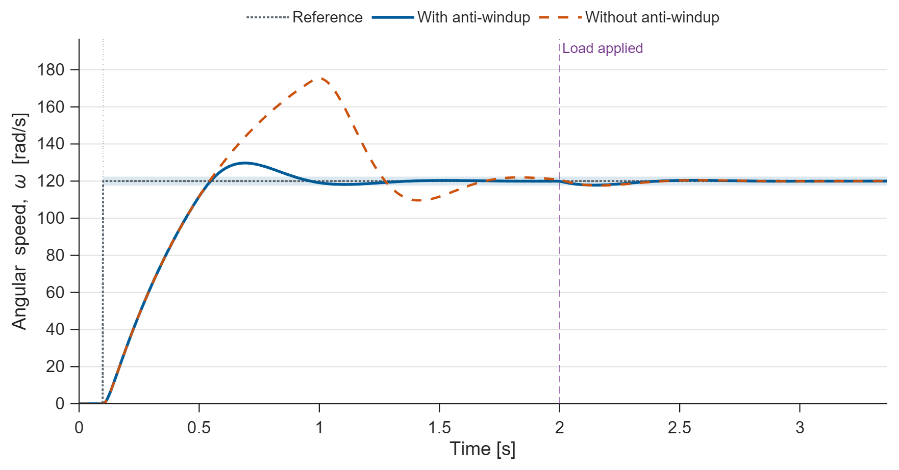
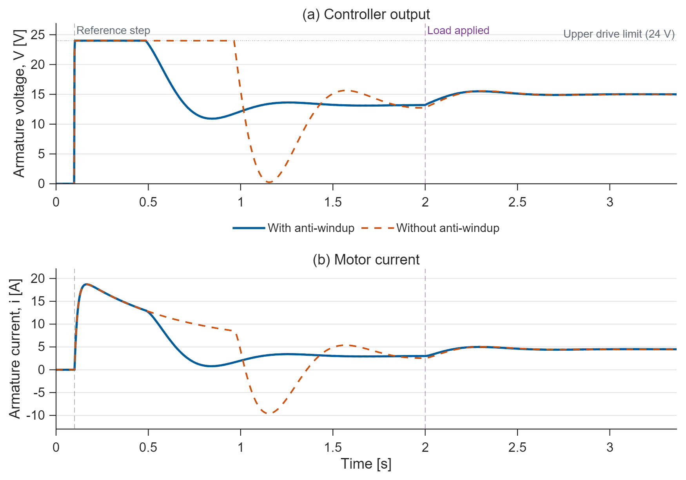
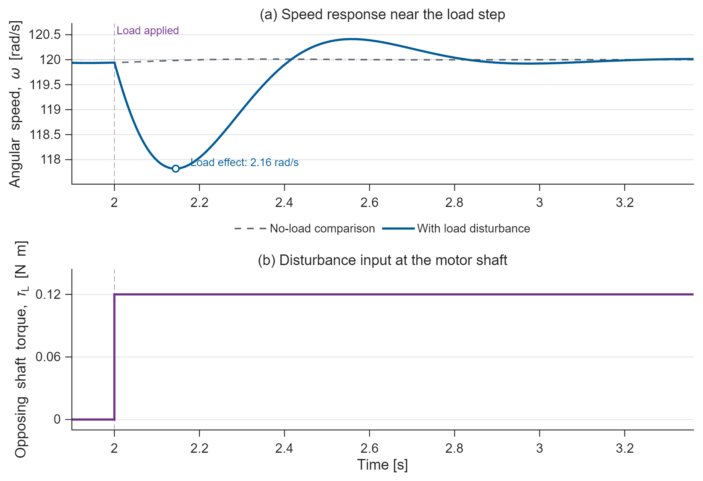
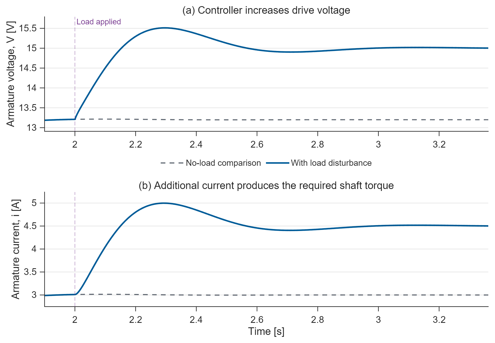

# DC Motor Speed Control

MATLAB/Simulink simulation of a DC motor with filtered PID, voltage saturation,
anti-windup, and a shaft-load disturbance.

## Run

Requires **MATLAB + Simulink**; verified on **R2025b**.
Open this repository's folder in MATLAB and run:

```matlab
run_demo
```

`run_demo(false)` exports the figures without opening windows.
Edit `motor_parameters.m` to change the experiment. Inspect the editable
[`dc_motor_speed_control.slx`](dc_motor_speed_control.slx) or its
[block-diagram preview](results/model.png).

## Results



**Figure 1. Complete speed response.** Both controllers receive the 120 rad/s
reference step at 0.1 s and the same 0.12 N m load at **2.0 s** (purple marker).
Anti-windup reduces startup overshoot from 46.16% to 8.11%. The plot continues
until both post-disturbance responses have settled, with 20% time headroom.
The pale region indicates the reference's 2% tracking tolerance.



**Figure 2. Complete control effort.** Voltage and current are shown for both
controllers through startup, the marked **2.0 s load step**, and final settling.
Without anti-windup, prolonged saturation leads to a larger speed overshoot and
negative braking current. Axes follow the actual signal ranges; the unused
-24 V voltage limit is omitted.



**Figure 3. Load rejection.** An opposing **0.12 N m shaft torque** is applied at
**2.0 s**, as marked on both panels. The speed initially falls and then recovers.
The peak load-induced deviation is 2.16 rad/s relative to the matched no-load
run. Speed returns within 2% of its post-load excursion from the reference
(0.0436 rad/s) after 1.112 s. The absolute speed remains inside the separate
2% reference-tracking tolerance throughout this disturbance.



**Figure 4. Controller response to the load.** At the marked load onset, the
speed error causes the controller to increase armature voltage and current.
They approach **15 V** and **4.5 A**, compared with **13.2 V** and **3 A** without
the load. Each axis follows the local signal range; no dual axes are used.

Figures are also available as vector PDFs in `results/`. `plot_results.m`
recreates them from the simulation tables. The two overview figures show
**0-3.362 s**, including the disturbance. The detail figures show **1.900-3.362 s**
with the same marked onset. The endpoint includes startup and post-load settling
of speed, current, and voltage for both controllers. The limiting post-load
settling duration is 1.134 s; 20% headroom gives 2.0 + 1.2 x 1.134 = 3.3608 s,
rounded up to the next 2 ms sample: **3.362 s**.

Startup speed settling uses 2% of the reference. For disturbance recovery, speed
uses 2% of its post-load excursion, while current and voltage use 2% of their
load-induced steady-state changes. This avoids declaring immediate recovery
merely because the small speed dip stays inside the reference-tracking tolerance.
An equation-level sizing solve selects the horizon before the final Simulink runs.

## Model and verification

$$L\dot{i}=V-Ri-K_e\omega,\qquad J\dot{\omega}=K_t i-b\omega-\tau_L.$$

The load enters the motor's mechanical balance, not the controller directly.
Its speed deviation changes the feedback error. The PID derivative acts on
measured speed to avoid derivative kick. The drive is limited to +/-24 V.
This illustrative model omits PWM switching, encoder quantization, sensor noise,
current limiting, and thermal effects; its parameters are not hardware-identified.

`run_demo` checks a separately implemented ODE solution, voltage bounds, tracking,
settling-window coverage, and steady-state electrical/torque balances.
Reproducible data and metrics are in `tracking.csv`, `load_response.csv`,
`parameters.json`, `figure_windows.json`, and `metrics.json` under `results/`.
The superseded five-second results are retained in `results/archive/v1/`.

## Relation to the book

Inspired by **P03** in Muhammad Mudassir Shakeel's
[*The MATLAB, Simulink & Simscape Project-Based Masterbook*](https://buymeacoffee.com/engrprogrammer).
This is **an independent topic-based implementation, not a reproduction**:
the book uses a 1 kHz discrete PI controller, encoder feedback, +/-12 V,
and speed reversal. This repository uses continuous filtered PID, ideal speed
feedback, +/-24 V, and a combined tracking/load sequence with different motor
parameters. No book code, figures, or paid project files are included.

Prepared with AI assistance and verified by simulation. Original repository
code is available under the [MIT License](LICENSE).
